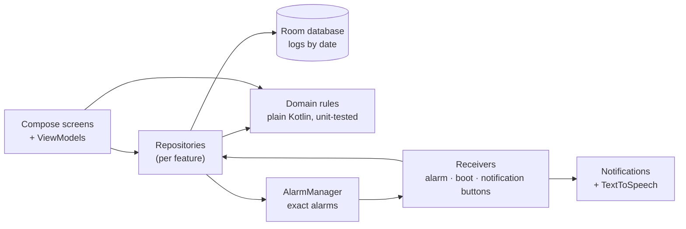

# Kaizen Android: architecture and roadmap

Kaizen is a personal productivity app: timers (with Pomodoro and a focus
log), habits, todos, journal, notes and milestones. This Android app replaces
the web app ([putrasurya/kaizen](https://github.com/putrasurya/kaizen)), which
is now only a reference for how features behave.

## Big picture

Everything runs on the phone. There is no server and no sync (ADR-002).

## Guiding ideas

1. **Store facts, compute the rest.** Save timestamps and dated logs; "this
   week", "time left" and "balance" are calculated from them. Nothing needs
   to run at midnight or tick in the background.
2. **Let Android wake us up.** Anything due later is an exact alarm, so it
   works even when the app is closed or killed.
3. **Rules are plain Kotlin.** The parts that can be wrong in subtle ways
   (Pomodoro breaks, habit debt, weekly reset) live in `domain` packages with
   unit tests, ported from the web app's tests.
4. **Small, reversible choices.** No extra libraries until they are needed.

## Decisions

| ADR | Decision | Status |
|---|---|---|
| [001](adr/001-native-android.md) | Native Android with Kotlin + Compose | Accepted |
| [002](adr/002-local-only-fresh-start.md) | Local-only data, fresh start, no sync | Accepted |
| [003](adr/003-app-structure.md) | One module, package per feature, plain Kotlin rules | Accepted |
| [004](adr/004-room-storage.md) | Room database, data kept as logs by date | Accepted |
| [005](adr/005-running-timers.md) | Running timers = saved end time + exact alarm | Accepted |

## Roadmap

Features are ported in order of daily use. Each phase is its own branch and
pull request, tested on a real phone before merging. Until a feature exists
here, keep using it in the web app.

| Phase | What |
|---|---|
| 0 ✅ | Prototype: exact alarm → notification → spoken message |
| 1 | Foundation: package structure, Room, `Clock`, navigation with bottom bar |
| 2a | Timers: create/edit per weekday, countdown that survives the app closing, sound at the end |
| 2b | Timers: reps per day |
| 2c | Timers: Pomodoro breaks (auto-break, long break every N rounds) |
| 2d | Timers: focus log and history |
| 3 | Habits: daily (fixed count) and routines (+/− balance, auto-tap), weekly view, history |
| 4 | Todos, plus a simple spoken reminder for unfinished tasks |
| 5 | Journal, plus "move unfinished task to journal" |
| 6 | Notes, milestones |
| Backlog | AI-written reminder messages (needs a small backend; never ship an API key in the app) |
| Not doing | Google Drive sync, importing web data, embeds |

## Working rules

- One feature per branch and pull request.
- Port behaviour from the web app's tests, rethought for a phone, not
  copied screen by screen.
- A new important decision gets a new ADR in `docs/adr/`.
- Test background behaviour (alarms, reboot) on a phone with aggressive
  battery saving (Xiaomi, Oppo, Vivo, Realme) as well as on stock Android.
